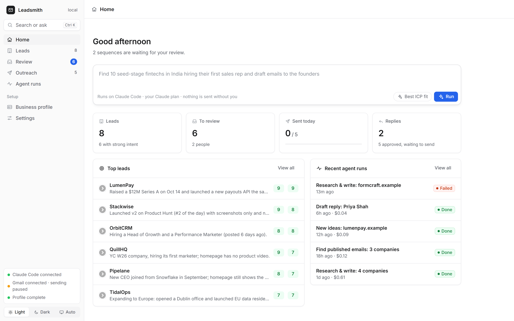
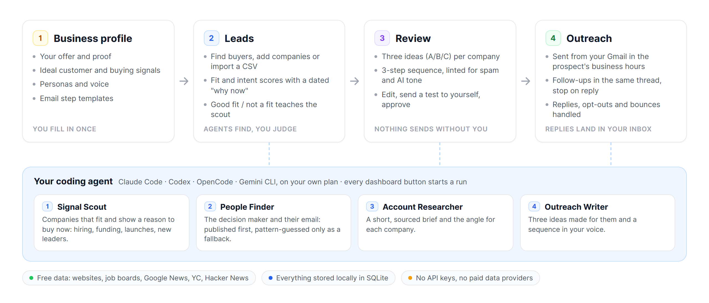
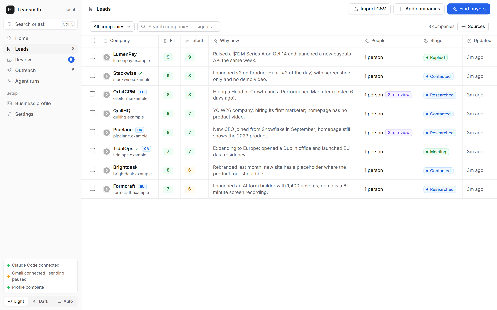
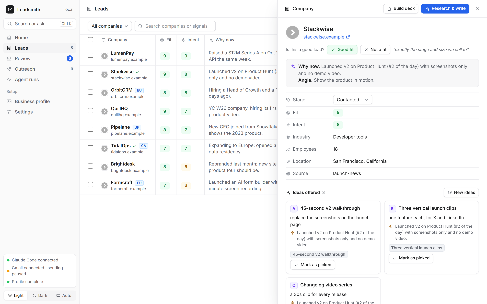
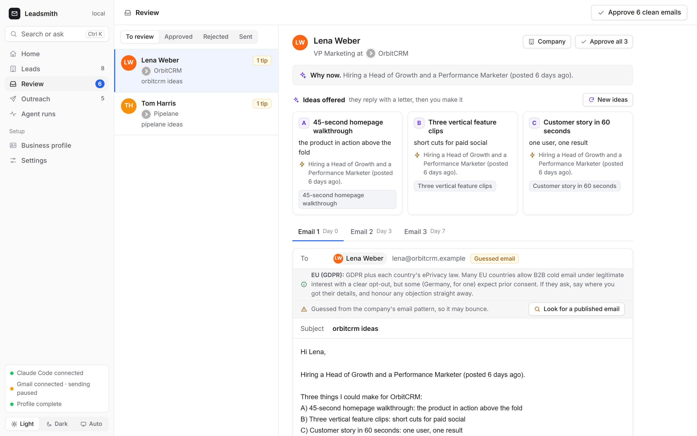
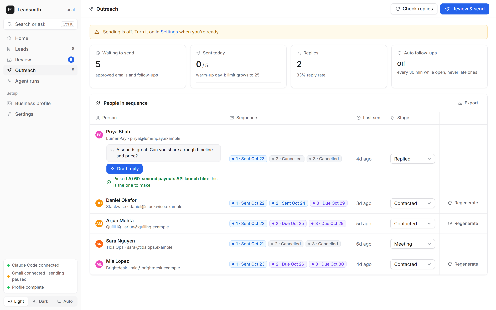
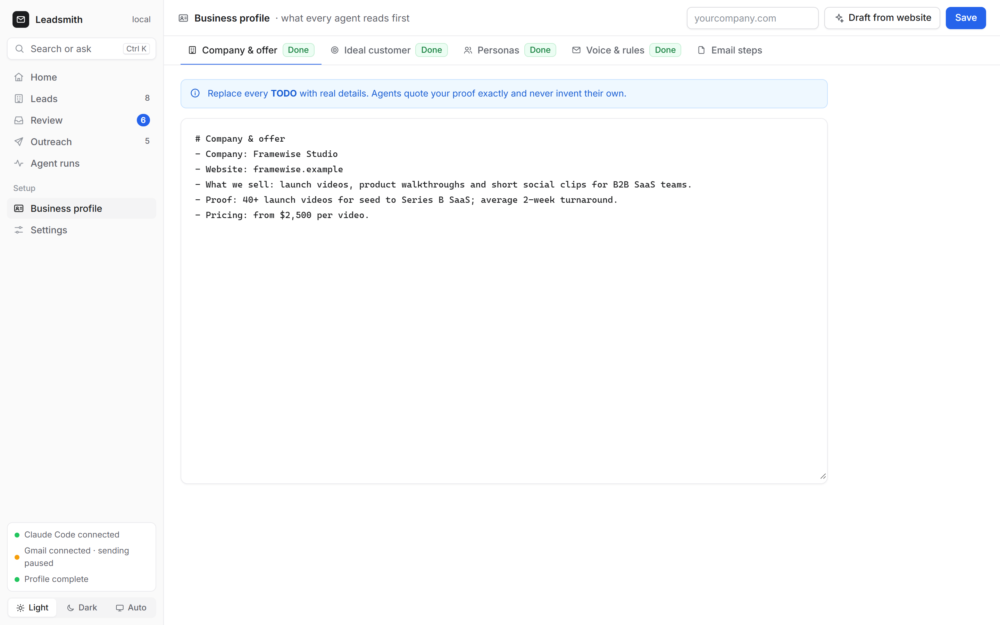
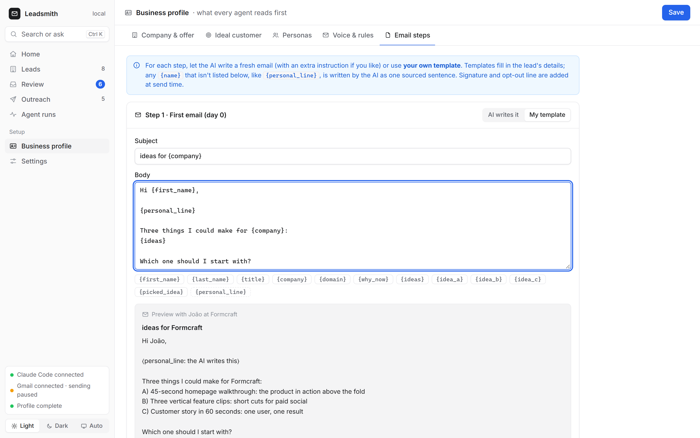
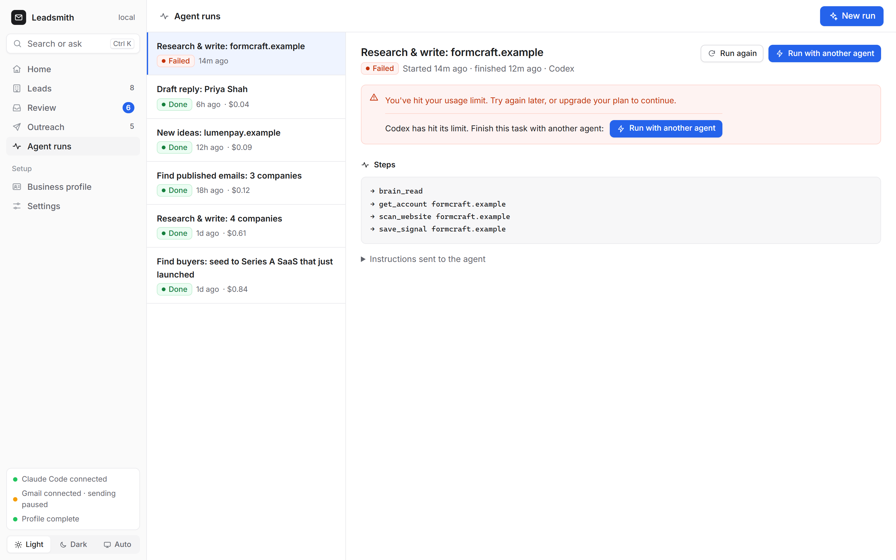
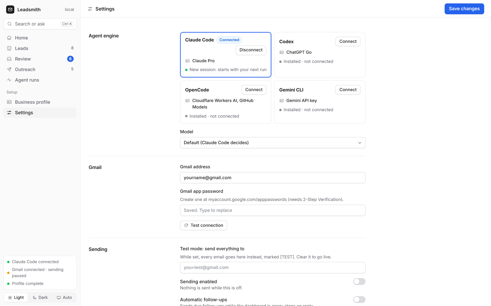

<p align="center">
  <picture>
    <source media="(prefers-color-scheme: dark)" srcset="docs/leadsmith-logo-dark.png">
    
  </picture>
</p>

<h1 align="center">Leadsmith</h1>

<p align="center">
  <b>Find buyers, write outreach they reply to, and send it from your Gmail,<br>from a local dashboard powered by the coding agent you already use.</b>
</p>

<p align="center">
  <a href="#install">Get started</a> ·
  <a href="#how-it-works">How it works</a> ·
  <a href="#a-tour-of-the-dashboard">Tour</a> ·
  <a href="#safety-rails">Safety</a> ·
  <a href="COMPLIANCE.md">Compliance</a> ·
  <a href="https://github.com/HariNayan/Leadsmith/issues">Report a bug</a>
</p>

<p align="center">
  <a href="https://github.com/HariNayan/Leadsmith/actions/workflows/test.yml"></a>
  <a href="LICENSE"></a>
  
  
  
  
  <a href="https://github.com/HariNayan/Leadsmith/stargazers"></a>
</p>

<p align="center">
  No API keys. No paid data providers. No SaaS subscription. Everything runs on your computer, on your own Claude, ChatGPT or Google plan.<br>
  <sub>One optional paid add-on, BetterContact email verification, stays off unless you add a key.</sub>
</p>



<sub>Screenshots use a demo workspace. Every company and person in them is fictional.</sub>

## What makes it different

Most cold email pitches. Leadsmith **offers**. For every lead, the agents find a real, dated reason to reach out now, then write three ideas made for that company. The prospect answers with a single letter:

```
Hi Daniel,

Stackwise launched v2 on Product Hunt (#2 of the day) with screenshots only and no demo video.

Three things I could make for Stackwise:
A) 45-second v2 walkthrough: replace the screenshots on the launch page
B) Three vertical launch clips: one feature each, for X and LinkedIn
C) Changelog video series: a 30s clip for every release

Which one should I make first: A, B or C?
```

"B" is the easiest reply anyone can send, and it tells you exactly what to build.

## How it works



- **The engine is the coding agent you already use**: Claude Code, Codex, OpenCode or Gemini CLI, running headless on your own plan. Pick one in **Settings → Agent engine**. Dashboard buttons start a background run, which you can watch live under **Agent runs**.
- **Four agents share one memory**: a local SQLite pipeline plus your business profile.
  1. **Signal Scout** finds companies that fit your ICP *and* show a reason to buy now: hiring, funding, new leaders, launches, tech.
  2. **People Finder** finds the decision maker and their email. It looks for an address published on their site first and only guesses from the company's pattern as a fallback.
  3. **Account Researcher** writes a short, sourced brief and the outreach angle.
  4. **Outreach Writer** writes three ideas and a 3-step sequence in your voice, plus an optional LinkedIn note and a 4-page PDF deck.
- **You stay in control.** Agents can research and draft, but they can never approve or send. Approving and sending are your clicks in the dashboard.

### Free data only

| Source | Gives you |
|---|---|
| Company websites | what they sell, pricing, team page, tech stack (60+ tools), socials, public emails, content freshness |
| Greenhouse / Lever / Ashby job boards | every open role, grouped by function: the strongest "need it now" signal |
| Google News | funding rounds, launches, leadership changes, expansions |
| Y Combinator directory | ~5,000 startups by industry, region, team size and hiring status |
| Hacker News "Who is hiring" | hundreds of hiring companies every month, with role and website |
| Your agent's web search / fetch | everything else: lists, directories, press, podcasts |
| DNS (MX) + email patterns | a likely email per person, labelled `guessed` until it's proven |
| Your CSV | import leads from Apollo, Sales Navigator, Clay, a CRM or a spreadsheet |

| Optional add-on | What it does | Cost |
|---|---|---|
| [BetterContact](https://bettercontact.rocks) | A **Verify** button on guessed emails: checks many providers and returns a verified address | Your BetterContact credits, charged only when it finds a usable email. Off unless `BETTERCONTACT_API_KEY` is set. One person per click; agents never spend credits. |

## A tour of the dashboard

### Leads: who to contact and why now

Every company gets a **Fit** score (how well it matches your ideal customer) and an **Intent** score (how strong and recent its buying signals are), with the one-line reason to reach out now. Flags such as **EU**, **UK** and **CA** mark leads in regions with stricter email rules. A ✓ means you marked the lead a good fit.



Use **Find buyers** to describe who you want in plain English, **Add companies** to paste domains, or **Import CSV** to bring your own list. **Sources** shows which discovery plays produced the leads you liked and the replies you got.

### Lead details: research, signals and ideas

Click a company to see the research brief, every signal with its source link, the people found, and the three ideas offered. Mark a lead **Good fit** or **Not a fit**, with a reason if you like. The scout reads these verdicts before every new search and looks for more like your good ones.



### Review: nothing goes out until you approve it

Every draft waits here. You see why now, the ideas, all three emails (day 0, 3 and 7), where the email address came from, and region notes. Edit anything, **Send test to me**, then **Approve**. Drafts with red issues from the linter (spammy words, AI-sounding phrases, links in a first email, unfilled `{placeholders}`) can't be approved.



### Outreach: sending, follow-ups and replies

Approved emails go out from your own Gmail, only in business hours in each prospect's time zone, one a minute, within your warm-up limit. Follow-ups reply in the same thread when they're due, and stop by themselves when someone replies. Replies show up inline: "A" marks idea A as picked, and **Draft reply** writes your answer for review.



### Business profile: what every agent reads first

Your company and offer, ideal customer, personas, and voice and rules. **Draft from website** fills a first version from your site. Agents quote only the proof written here and never invent their own.



### Email steps: AI-written or your own template

For each step, either let the AI write a fresh email, with an extra instruction if you like, or use **your own template**. Templates fill in lead fields such as `{first_name}`, `{company}` and `{ideas}`. Any other `{name}`, like `{personal_line}`, becomes one sourced sentence the AI writes. A live preview shows the result on a real lead.



### Agent runs and settings

Every run shows its status, live log and cost. Settings holds your Gmail connection (with **Test connection**), sending hours, warm-up, the daily limit, signature and postal address, the optional BetterContact key, and a short note on sending responsibly.

| Agent runs | Settings |
|---|---|
|  |  |

## Install

You need **one coding agent**, installed and signed in (see [Choose your agent engine](#choose-your-agent-engine)), and **[uv](https://docs.astral.sh/uv/getting-started/installation/)**. uv installs Python for you. Chrome or Edge is optional, for PDF decks.

```bash
# Windows (PowerShell):  powershell -ExecutionPolicy ByPass -c "irm https://astral.sh/uv/install.ps1 | iex"
curl -LsSf https://astral.sh/uv/install.sh | sh
```

```bash
git clone https://github.com/HariNayan/Leadsmith.git
```

```bash
cd Leadsmith
```

```bash
uv sync
```

Open the dashboard. Run this from inside the `Leadsmith` folder, and keep the terminal open while you use it:

```bash
uv run leadsmith
```

From any other folder, point uv at the project instead. This works in PowerShell, cmd and bash:

```bash
uv run --directory C:/path/to/Leadsmith leadsmith
```

On Windows you can double-click **`Start Leadsmith.cmd`** in the project folder instead.

It opens **http://127.0.0.1:4600**. Closing the terminal stops the dashboard. Check your setup any time with:

```bash
uv run leadsmith doctor
```

## Choose your agent engine

Leadsmith works with any of these. Install one, sign in once in a terminal, then pick it in **Settings → Agent engine**. Settings shows which ones are installed and signed in.

| Engine | Install | Sign in | Notes |
|---|---|---|---|
| **[Claude Code](https://claude.com/claude-code)** | see the site | `claude`, then `/login` | Runs the four agents as real sub-agents. Shows the cost of each run. |
| **[Codex](https://developers.openai.com/codex)** | `npm install -g @openai/codex` | `codex login` | Uses your ChatGPT plan. Live web search on. |
| **[OpenCode](https://opencode.ai)** | `npm install -g opencode-ai` | `opencode auth login` | Any provider you've added (Anthropic, OpenAI, GitHub Models, local…). Shows cost when the provider reports it. |
| **[Gemini CLI](https://geminicli.com)** | `npm install -g @google/gemini-cli` | `gemini`, then sign in with Google (or set `GEMINI_API_KEY`) | Uses your Google account. |

Every engine gets the same Leadsmith tools and the same limits. It can use the Leadsmith tools and the web, but not shell commands, file edits, or the tools that approve and send email. Engines without sub-agents get the four agents' playbooks and do each role in turn. **Model** in Settings is optional. Leave it empty for the engine's default, or use that engine's own model names (e.g. `sonnet`, `gpt-5.5`, `anthropic/claude-sonnet-5-5`, `gemini-3.6-flash`).

### Also chat with Leadsmith inside your agent (optional)

The dashboard is the main way to work, but you can also give your agent Leadsmith's tools and chat with it. Replace `C:/path/to/Leadsmith` with your folder.

**Claude Code**: the repo is a Claude Code plugin, with the agents and skills included:

```
/plugin marketplace add HariNayan/Leadsmith
/plugin install leadsmith@leadsmith
```

Or, from a clone: `claude --plugin-dir ./Leadsmith`. Then try `/leadsmith:setup`, `/leadsmith:find-buyers 10 fintechs in India hiring sales` or `/leadsmith:dashboard`.

**Codex**:

```bash
codex mcp add leadsmith -- uv run --directory C:/path/to/Leadsmith leadsmith serve
```

**OpenCode**: add this to `opencode.json` (in your project, or `~/.config/opencode/opencode.json`):

```json
{
  "mcp": {
    "leadsmith": { "type": "local", "command": ["uv", "run", "--directory", "C:/path/to/Leadsmith", "leadsmith", "serve"] }
  }
}
```

**Gemini CLI**: add this to `~/.gemini/settings.json`:

```json
{
  "mcpServers": {
    "leadsmith": { "command": "uv", "args": ["run", "--directory", "C:/path/to/Leadsmith", "leadsmith", "serve"] }
  }
}
```

Then ask, for example, *"Use the leadsmith tools: read the business profile, then find 5 companies that just raised a seed round and save them."*

## First run (10 minutes)

1. **Business profile**: enter your website and click **Draft from website**, then replace the remaining `TODO`s with real details (proof, buyer signals, voice).
2. **Settings**: connect Gmail. Any personal @gmail.com works. Turn on 2-Step Verification, create an App Password at <https://myaccount.google.com/apppasswords>, paste it, then click **Test connection**. Add your sender name, signature and postal address.
3. **Leads → Find buyers**: e.g. *"10 seed to Series A fintechs in India hiring their first sales rep"*.
4. **Review**: edit, **Send test to me**, then **Approve**.
5. **Outreach**: turn **Sending** on in Settings, then click **Review & send**. Follow-ups go out in the same thread when they're due and stop automatically when someone replies.

Tip: set **Test mode** in Settings to your own address while you try it out. Every email then goes to you, marked `[TEST]`.

## Safety rails

- Nothing sends unless you approved the draft, **Sending** is on, and you confirmed the preview.
- Drafts with red lint issues can't be approved.
- Agents may only cite facts with a saved source URL, or your own business profile.
- Emails go out only inside business hours in the **prospect's** time zone (default 9–17, weekdays), one a minute, with follow-ups counted in business days. Opening the app after a break never fires a burst of late follow-ups.
- **Warm-up**: a new sender starts at 5 emails a day and adds 3 a day up to your daily limit (default 25).
- Every email gets an opt-out line, a `List-Unsubscribe` header and your postal address. A do-not-contact list is checked before every send, and opt-out replies and bounces are added to it automatically.
- Guessed emails are clearly labelled. Send small batches first, since bounces hurt your sender reputation.
- The dashboard only listens on `127.0.0.1` and rejects cross-site and DNS-rebinding requests.
- Leads that look like they're in the **EU/EEA, UK, Switzerland or Canada** get a flag with that region's rule in one line.
- You are responsible for following email and privacy law where you and your recipients are. Read **[COMPLIANCE.md](COMPLIANCE.md)** (a summary, not legal advice).

## Where your data lives

```
~/.leadsmith/     (Windows: C:\Users\<you>\.leadsmith)
├── .env          Gmail + sending settings (edited from the dashboard)
├── brain/        company.md · icp.md · personas.md · voice.md
├── leadsmith.db  accounts, signals, contacts, drafts, ideas, runs (SQLite)
├── decks/        generated PDF decks
└── exports/      CSV exports (Instantly, Smartlead, Lemlist, HubSpot…)
```

Nothing leaves your computer except the emails you approve and the web lookups the agents make.

**Exports** use the column names Instantly and Smartlead map automatically (`email, first_name, last_name, company, title, website, linkedin_url`). After those come `reason` (why now), `idea_a/b/c`, `step1_subject`, `step1_body`, `step2_body` and `step3_body`, plus `timezone` and `strict_region`, all usable as custom variables. Opted-out and bounced people are left out.

Set `LEADSMITH_HOME` to keep a separate workspace per client or product. Coming from GTM Brain (the old name)? Your `~/.gtm-brain` folder is moved to `~/.leadsmith` on first start, with nothing lost.

## Commands

| Command | What it does |
|---|---|
| `uv run leadsmith` | open the dashboard (`--port 4700`, `--no-open`) |
| `uv run leadsmith doctor` | check the agent engines, free sources, PDF renderer, Gmail, profile |
| `uv run leadsmith serve` | MCP server over stdio (what your agent launches) |
| `uv run leadsmith init` | create the workspace without opening the dashboard |

## Development

```bash
uv run python -m unittest discover -s tests -v
```

```bash
claude plugin validate .
```

Layout:

```
src/leadsmith/
├── server.py        MCP tools the agents use
├── dashboard.py     local API · web/ is the UI
├── jobs.py          runs the chosen agent in the background
├── engines.py       Claude Code, Codex, OpenCode and Gemini CLI adapters
├── providers/       free data sources (+ optional BetterContact)
├── mailer.py        Gmail sending, replies, bounces, warm-up
├── schedule.py      prospect time zones and the sending window
├── templates.py     email step templates
├── compliance.py    strict-region flags
├── lint.py          copy checks
└── decks.py         PDF decks
agents/  skills/     the four agents and the Claude Code skills
```

## Credits

Inspired by [4ruple](https://basementprotocol.com/4ruple) (the local-app, your-own-Claude approach) and by open-source sales and outreach projects. See [NOTICE.md](NOTICE.md).

## License

MIT
